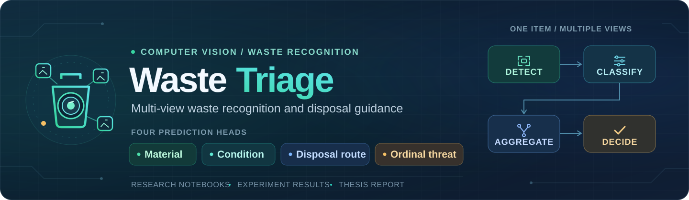
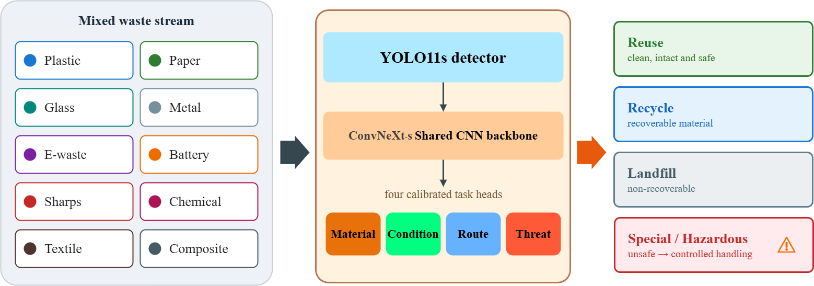

<div align="center">



<p>
  
  
  
  
  
</p>

**Multi-view waste recognition and disposal guidance**

[Overview](#overview) · [Results](#selected-results) · [Notebooks](#notebook-workflow) · [Using the notebooks](#reproduce-model-experiments) · [Evaluation notes](#evaluation-notes) · [Build the thesis](#build-the-thesis)

</div>

## Overview

Waste Triage is a two-stage research system that locates a waste item in a photograph and predicts its **material, condition, disposal route, and ordinal threat**. Predictions from multiple photographs are combined for each physical item. A decision layer recommends **Reuse, Recycle, Landfill, Special handling, or Unsure** for review.

This repository contains the experiment notebooks, exported results, and complete LaTeX report source with editable diagrams. Model checkpoints and cached logits are excluded to keep the repository lightweight.

## Quick start

| Explore | Start here |
| --- | --- |
| Read the thesis | [Complete thesis PDF](Thesis_Report_Threat-Aware_Waste_Detection_and_Classification.pdf). |
| Research and system design | [Methodology](Report/chapters/methodology.tex) and [Results and discussions](Report/chapters/result-analysis.tex). |
| Results and charts | [Results](Results/) and [report figures](Report/figures/). |
| Experiment code | [Notebook directory](#notebook-workflow) and [shared Python helper](Notebooks/thesis_common.py). |
| Report and diagrams | [Build instructions](#build-the-thesis) and [editable Draw.io diagrams](Report/DrawIo/). |

## Repository contents

| Path | Contents |
| --- | --- |
| [`Notebooks/`](Notebooks/) | 27 experiment notebooks, the report-figure notebook, and `thesis_common.py`. |
| [`Results/`](Results/) | JSON metrics, CSV histories, exported tables, and plots grouped by experiment. |
| [`Report/`](Report/) | LaTeX chapters, bibliography, document class, build configuration, and report figures. |
| [`Report/DrawIo/`](Report/DrawIo/) | Editable diagram sources. |
| [Thesis PDF](Thesis_Report_Threat-Aware_Waste_Detection_and_Classification.pdf) | Complete report, ready to read. |

<details>
<summary><strong>System overview and dataset</strong></summary>



1. **Detect:** a single-class YOLO detector locates the waste item.
2. **Classify:** a shared backbone predicts four tasks from the crop. ConvNeXt-S is the reference classifier; CNN, transformer, and fusion alternatives are also evaluated.
3. **Aggregate:** combine predictions across the photographs belonging to the same item.
4. **Decide:** apply disposal rules and confidence checks to produce the final route or a review referral.

The current dataset summary contains **485 physical items**: 385 training, 50 validation, and 50 test items. It records **5,363 image rows**, including training augmentation rows; the test set contains 221 views. Splits and primary classifier evaluation operate at the physical-item level, keeping an item's views together. See [`data_summary.json`](Results/SC1/data_summary.json).

The ten material classes are plastic, paper, metal, glass, textile, e-waste, battery, sharps, hazardous chemical, and composite. Condition is Good/Poor; the learned route head has four disposal classes. The decision layer adds Unsure. Threat is ordinal, with level 0 reserved and no level-0 support in the reference test set.

</details>

## Selected results

These are saved results, with their evaluation cohorts identified explicitly.

| Evaluation | Highlight | Cohort |
| --- | --- | --- |
| [Reference classifier](Results/SC12/metrics_convnext_small.fb_in22k_ft_in1k.json) | Material macro-F1 **0.8395** | 50 held-out items |
| [Detector reevaluation](Results/SC27/detector_reeval.json) | mAP@50 **0.9922** | 50 items / 221 views |
| [Integrated pipeline](Results/SC18/end_to_end_results.json) | Route macro-F1 **0.7242** | 50 held-out items |

The current dataset contains **485 physical items**. Historical SC9 results use a separate 457-item cohort. Classifier scores use items; detector scores use views. See [evaluation notes](#evaluation-notes) before comparing results.

<details>
<summary><strong>Detailed metrics</strong></summary>

| Evaluation | Support | Selected metrics | Source |
| --- | --- | --- | --- |
| ConvNeXt-S reference classifier | 50 held-out items | Material accuracy **0.8400**; material macro-F1 **0.8395**; condition AUROC **0.8647**; route macro-F1 **0.7396**; threat QWK **0.8261** | [SC12 metrics](Results/SC12/metrics_convnext_small.fb_in22k_ft_in1k.json) |
| Current detector reevaluation | 50 items / 221 views | mAP@50 **0.9922**; mAP@50–95 **0.8534**; precision **0.9776**; recall **0.9892** | [SC27 metrics](Results/SC27/detector_reeval.json) |
| Integrated detector-crop pipeline | 50 held-out items | Material macro-F1 **0.8395**; route macro-F1 **0.7242**; condition AUROC **0.8631**; threat QWK **0.8261** | [SC18 metrics](Results/SC18/end_to_end_results.json) |
| Historical pooled out-of-fold evaluation | 457 items | Material accuracy **0.8315**; material macro-F1 **0.8033** | [SC9 metrics](Results/SC9/kfold_convnext_small_metrics.json) |

The item-level classifier scores and view-level detector scores describe different evaluation units. See [evaluation notes](#evaluation-notes) for cohort and protocol boundaries.

</details>

## Notebook workflow

The notebooks cover data preparation, model training, evaluation, and visualization. Each notebook documents its experiment.

<details>
<summary><strong>Notebook directory</strong></summary>

| Topic | Notebooks |
| --- | --- |
| Data preparation | [SC1](Notebooks/SC1_data_prep_eda.ipynb) |
| CNN classifiers | [SC2](Notebooks/SC2_train_efficientnet_b0.ipynb), [SC3](Notebooks/SC3_train_convnext_tiny.ipynb), [SC4](Notebooks/SC4_train_resnet50.ipynb), [SC5](Notebooks/SC5_train_mobilenetv3_large_100.ipynb), [SC12](Notebooks/SC12_train_convnext_small_in22k.ipynb) |
| Transformer classifiers | [SC13](Notebooks/SC13_train_dinov2_vits.ipynb), [SC23](Notebooks/SC23_vit_base_dinov2.ipynb), [SC24](Notebooks/SC24_vit_base_siglip.ipynb), [SC25](Notebooks/SC25_vit_small_dinov2_reg.ipynb) |
| Calibration and fusion | [SC6](Notebooks/SC6_calibrate_ensemble_eval.ipynb), [SC7](Notebooks/SC7_fusion_train_eval.ipynb), [SC26](Notebooks/SC26_fusion_vitb.ipynb) |
| Detection | [SC8](Notebooks/SC8_detection_yolo.ipynb), [SC16](Notebooks/SC16_detection_benchmark.ipynb), [SC27](Notebooks/SC27_detector_reeval.ipynb) |
| Classifier benchmark | [SC17](Notebooks/SC17_classification_benchmark.ipynb) |
| Cross-validation | [SC9](Notebooks/SC9_kfold_cv.ipynb), [SC20](Notebooks/SC20_5fold_cv.ipynb) |
| Multi-view aggregation | [SC15](Notebooks/SC15_view_aggregation.ipynb) |
| Pipeline evaluation and material-only control | [SC18](Notebooks/SC18_end_to_end_results.ipynb), [SC28](Notebooks/SC28_singletask_material.ipynb) |
| External validation | [SC10](Notebooks/SC10_external_validation.ipynb), [SC10b](Notebooks/SC10b_trashnet_finetune.ipynb) |
| Interpretability and walkthroughs | [SC21](Notebooks/SC21_gradcam.ipynb), [SC22](Notebooks/SC22_qualitative_demo.ipynb), [SC30](Notebooks/SC30_pipeline_walkthrough.ipynb) |
| Report charts | [Report figures](Notebooks/Report_Figures.ipynb) |

</details>

### Reproduce model experiments

Open the notebooks in Jupyter and follow their setup and input cells. Shared utilities are in [`thesis_common.py`](Notebooks/thesis_common.py). The Python workflows use packages such as PyTorch, NumPy, pandas, scikit-learn, and Matplotlib; detection workflows use Ultralytics.

Running the experiments requires the dataset and model files specified in each notebook. These inputs are not bundled with the repository.

Saved plots are available in [`Report/figures/`](Report/figures/) and [`Results/Report_Figures/`](Results/Report_Figures/). The report uses these figures directly.

## Kaggle resources

<details>
<summary><strong>Notebook and dataset links</strong></summary>

- [Waste dataset (version 1)](https://www.kaggle.com/datasets/fbanabil/waste-10class/versions/1)
- [Shared helper dataset](https://www.kaggle.com/datasets/fbanabil/thesis-common-10c?select=thesis_common.py)

| Experiment | Kaggle page |
| --- | --- |
| SC1 | [Notebook](https://www.kaggle.com/code/fbanabil/sc1-data-prep-eda/notebook?scriptVersionId=332834119) |
| SC2 | [Outputs](https://www.kaggle.com/code/fbanabil/sc2-train-efficientnet-b0/output?scriptVersionId=332701992) |
| SC3 | [Notebook](https://www.kaggle.com/code/fbanabil/sc3-train-convnext-tiny/notebook?scriptVersionId=332725775) |
| SC4 | [Notebook](https://www.kaggle.com/code/fbanabil/sc4-train-resnet50/notebook?scriptVersionId=332728624) |
| SC5 | [Notebook](https://www.kaggle.com/code/fbanabil/sc5-train-mobilenetv3-large-100/notebook?scriptVersionId=332733885) |
| SC6 | [Notebook](https://www.kaggle.com/code/fbanabil/sc6-calibrate-ensemble-eval/notebook?scriptVersionId=332689544) |
| SC7 | [Notebook](https://www.kaggle.com/code/fbanabil/sc7-fusion-train-eval/notebook?scriptVersionId=332752690) |
| SC8 | [Notebook](https://www.kaggle.com/code/fbanabil/sc8-detection-yolo/notebook?scriptVersionId=330387383) |
| SC9 | [Notebook](https://www.kaggle.com/code/fbanabil/sc9-kfold-cv/notebook?scriptVersionId=330742352) |
| SC10 | [Notebook](https://www.kaggle.com/code/fbanabil/sc10-external-validation/notebook?scriptVersionId=332830208) |
| SC10b | [Notebook](https://www.kaggle.com/code/fbanabil/sc10b-trashnet-finetune/notebook?scriptVersionId=332830320) |
| SC12 | [Notebook](https://www.kaggle.com/code/fbanabil/sc12-train-convnext-small-in22k/notebook?scriptVersionId=332665957) |
| SC13 | [Notebook](https://www.kaggle.com/code/fbanabil/sc13-train-dinov2-vits/notebook?scriptVersionId=332737544) |
| SC15 | [Notebook](https://www.kaggle.com/code/fbanabil/sc15-view-aggregation?scriptVersionId=357283065) |
| SC16 | [Notebook](https://www.kaggle.com/code/fbanabil/sc16-detection-benchmark/notebook?scriptVersionId=332334964) |
| SC17 | [Notebook](https://www.kaggle.com/code/fbanabil/sc17-classification-benchmark/notebook?scriptVersionId=332828216) |
| SC18 | [Notebook](https://www.kaggle.com/code/fbanabil/sc18-end-to-end-results/notebook?scriptVersionId=332689968) |
| SC20 | [Notebook](https://www.kaggle.com/code/fbanabil/sc20-5fold-cv?scriptVersionId=332491207) |
| SC21 | [Notebook](https://www.kaggle.com/code/fbanabil/sc21-gradcam/notebook?scriptVersionId=356800227) |
| SC22 | [Notebook](https://www.kaggle.com/code/fbanabil/sc22-qualitative-demo/notebook?scriptVersionId=356670785) |
| SC23 | [Notebook](https://www.kaggle.com/code/fbanabil/sc23-vit-base-dinov2/notebook?scriptVersionId=332834475) |
| SC24 | [Notebook](https://www.kaggle.com/code/fbanabil/sc24-vit-base-siglip/notebook?scriptVersionId=332834922) |
| SC25 | [Notebook](https://www.kaggle.com/code/fbanabil/sc25-vit-small-dinov2-reg/notebook?scriptVersionId=332853372) |
| SC26 | [Notebook](https://www.kaggle.com/code/fbanabil/sc26-fusion-vitb/notebook?scriptVersionId=333049882) |
| SC27 | [Notebook](https://www.kaggle.com/code/fbanabil/sc27-detector-reeval/notebook?scriptVersionId=333053210) |
| SC28 | [Notebook](https://www.kaggle.com/code/fbanabil/sc28-singletask-material/notebook?scriptVersionId=333280128) |
| SC30 | [Notebook](https://www.kaggle.com/code/fbanabil/sc30-pipeline-walkthrough/notebook?scriptVersionId=336195771) |
| Report figures | [Notebook](https://www.kaggle.com/code/fbanabil/figures) |

</details>

## Evaluation notes

- Classifier metrics are evaluated per physical item after combining views; detector metrics are evaluated per image.
- The main held-out evaluation uses 50 items. SC9 reports a separate historical cohort of 457 items; supplementary SC19 results use 46 items.
- Route-head scores measure classification, while final disposal recommendations also apply the decision policy. SC18 uses base crops without SC12's flip-TTA and includes an oracle-crop fallback when detection is missed.
- SC6 calibration applies to SC7 fusion. SC10b selects checkpoints using test accuracy, so its fine-tuning comparison is exploratory.

## Build the thesis

Install a LaTeX distribution providing **XeLaTeX, Biber, and latexmk**, together with the packages requested by the thesis class and resources. From the repository root:

```sh
cd Report
latexmk -xelatex -interaction=nonstopmode -file-line-error main.tex
```

The output is `Report/main.pdf`. The [build configuration](Report/.latexmkrc) selects XeLaTeX and Biber; bibliography entries are in [`references.bib`](Report/bib/references.bib). The report uses its included figures directly, so compiling it does not require running the Python notebooks. Draw.io sources remain editable alongside their exported report images.
